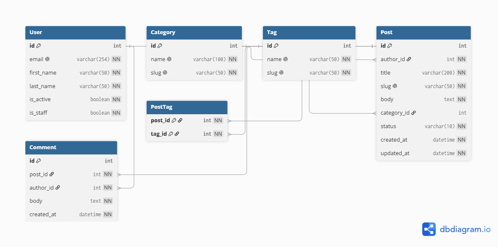
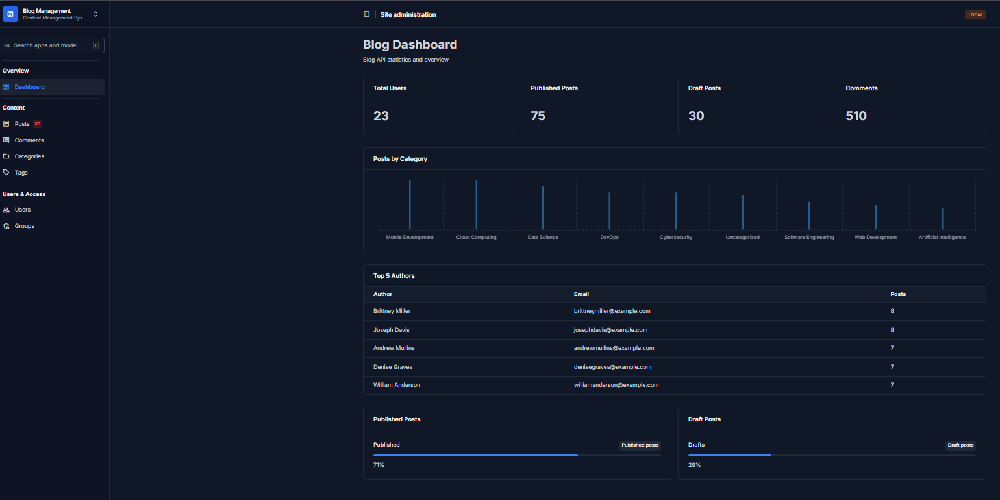
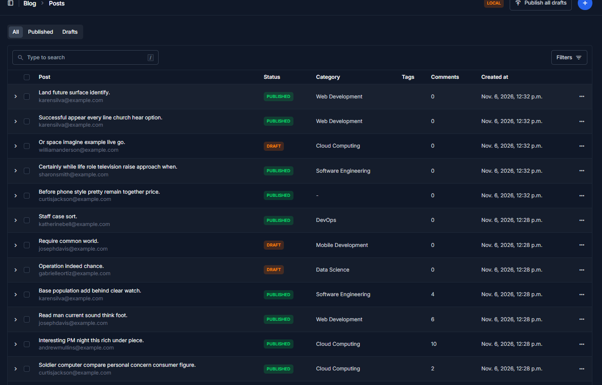

# Blog API

## ERD

Homework 2 — Database Seeding & Django Unfold Admin

Overview

This homework extends the Blog REST API project with a database seeding command and a customized Django Unfold administration panel.

Seeding

The seed management command generates sample data for users, categories, tags, posts, and comments using Faker.

Run with default values:

python manage.py seed

Available arguments:
Argument     Default     Description
--users       20         Number of users to generate
--posts       100        Number of posts to generate
--comments    500        Number of comments to generate
--clear       Off        Delete existing data before seeding, preserving superusers

Example:

python manage.py seed --users 50 --posts 300 --comments 1500

Reset and regenerate sample data:
python manage.py seed --clear

The command uses bulk creation for users, posts, and comments, generates unique emails and slugs, and assigns randomized relationships.

Django Unfold Admin

The project uses Django Unfold to provide a modern administration interface.
Implemented features include:
- Customized blue primary color palette and environment badge.
- Custom sidebar navigation and model search.
- Post tabs for All, Published, and Drafts.
- Category and Tag management with automatic slugs and sortable post counts.
- Comment search, autocomplete filters, and date filtering.
- Custom User Admin with status labels, filters, tabs, and bulk actions.
- Post management with WYSIWYG editing, publishing actions, filters, and inline comments.
- Dashboard with statistics, posts by category chart, top authors, and publication progress bars.

Admin URL:
http://127.0.0.1:8000/admin/

Admin Screenshots
Dashboard

Post List with Filters

Post Edit Page

User List

Running the Project
After configuring the environment and installing dependencies, run:

python manage.py migrate
python manage.py seed
python manage.py createsuperuser
python manage.py runserver

Then open the admin panel at http://127.0.0.1:8000/admin/.

Technologies
Python
Django 5.2
Django REST Framework
Django Unfold
Faker
SQLite for local development