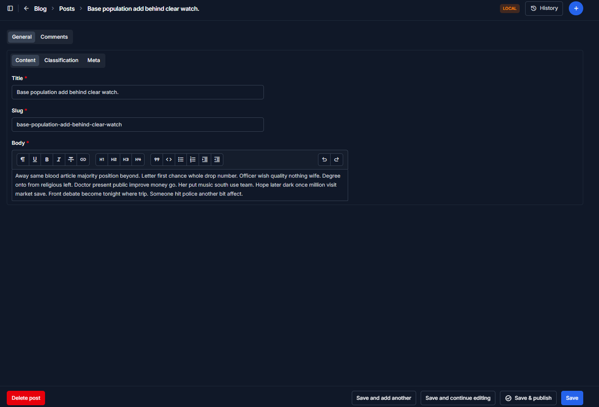
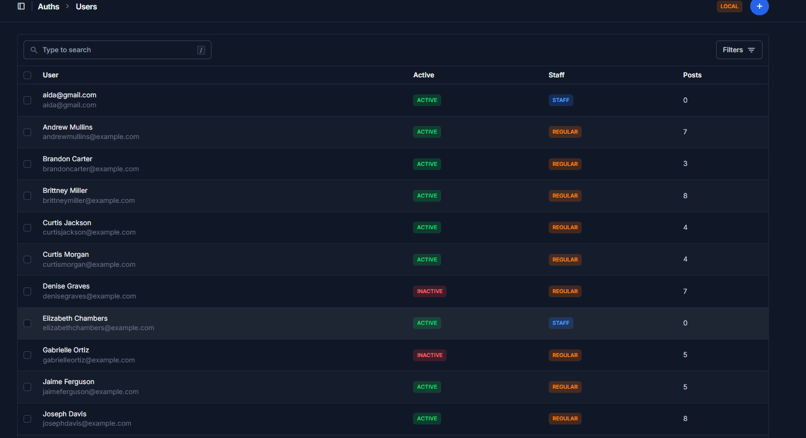

# Blog API

## ERD


Homework 2 — Database Seeding & Django Unfold Admin

Overview

This homework extends the Blog REST API project with a database seeding command and a customized Django Unfold administration panel.

Seeding

The seed management command generates sample data for users, categories, tags, posts, and comments using Faker.

Run with default values:

python manage.py seed

Available arguments:
Argument     Default     Description
--users       20         Number of users to generate
--posts       100        Number of posts to generate
--comments    500        Number of comments to generate
--clear       Off        Delete existing data before seeding, preserving superusers

Example:

python manage.py seed --users 50 --posts 300 --comments 1500

Reset and regenerate sample data:
python manage.py seed --clear

The command uses bulk creation for users, posts, and comments, generates unique emails and slugs, and assigns randomized relationships.

Django Unfold Admin

The project uses Django Unfold to provide a modern administration interface.
Implemented features include:
- Customized blue primary color palette and environment badge.
- Custom sidebar navigation and model search.
- Post tabs for All, Published, and Drafts.
- Category and Tag management with automatic slugs and sortable post counts.
- Comment search, autocomplete filters, and date filtering.
- Custom User Admin with status labels, filters, tabs, and bulk actions.
- Post management with WYSIWYG editing, publishing actions, filters, and inline comments.
- Dashboard with statistics, posts by category chart, top authors, and publication progress bars.

Admin URL:
http://127.0.0.1:8000/admin/

Admin Screenshots
Dashboard


Post List with Filters


Post Edit Page


User List


Running the Project
After configuring the environment and installing dependencies, run:

python manage.py migrate
python manage.py seed
python manage.py createsuperuser
python manage.py runserver

Then open the admin panel at http://127.0.0.1:8000/admin/.

Technologies
Python
Django 5.2
Django REST Framework
Django Unfold
Faker
SQLite for local development


## Queries

Homework 3 includes 50 Django ORM queries implemented in
`apps/blog/queries.py`.

The management command is located at
`apps/blog/management/commands/queries.py`.

### Run all read queries

```bash
python manage.py queries
```

Runs all read queries except 40–44, which modify database data.

### Run a specific query

```bash
python manage.py queries --number 31
```

Example output:

```text
31 categories_with_post_count — 1 SQL query
Data Science {'post_count': 13}
Artificial Intelligence {'post_count': 12}
Cloud Computing {'post_count': 12}
DevOps {'post_count': 12}
Mobile Development {'post_count': 11}
(8 rows)
```

### Show executed SQL

```bash
python manage.py queries --number 6 --sql
```

Example output:

```text
6 has_drafts — 1 SQL query
SELECT 1 AS "a" FROM "blog_post" WHERE "blog_post"."status" = 'draft' LIMIT 1
True
```

### Data-modifying queries

Queries 40–44 change database records and are not included
in the default command.

Run them individually:

```bash
python manage.py queries --number 41
```

To reset the development database with fresh sample data:

```bash
python manage.py seed --clear
```

Warning: `--clear` deletes existing sample data.

### Initial setup

```bash
python manage.py migrate
python manage.py seed
python manage.py queries
python manage.py queries --number 41
```
